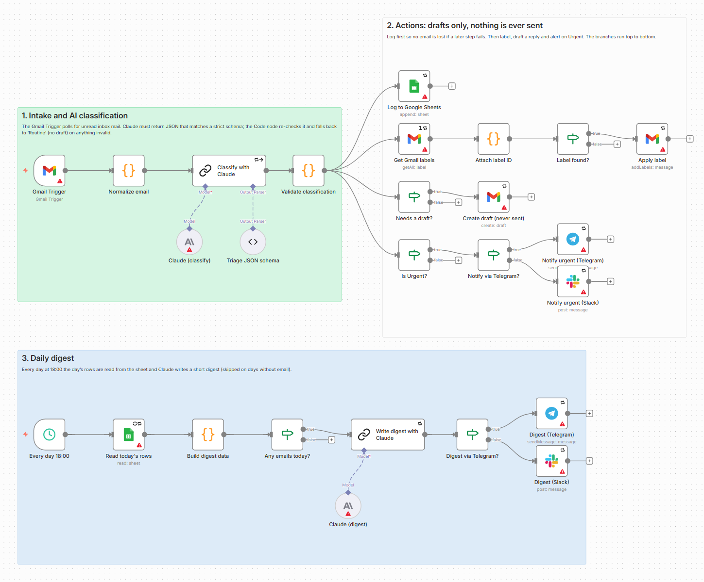
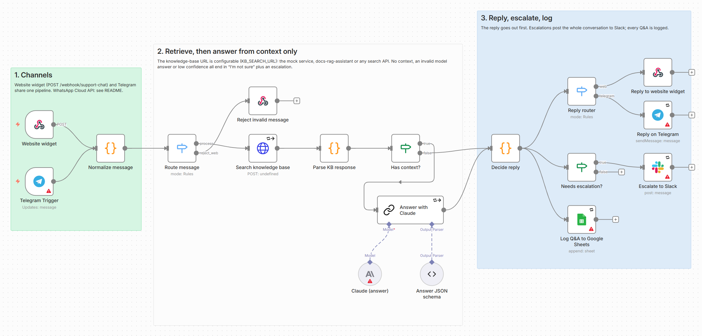
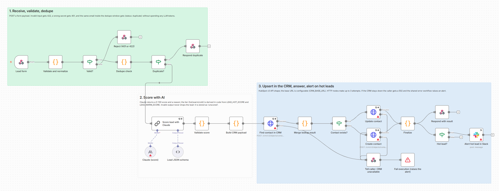
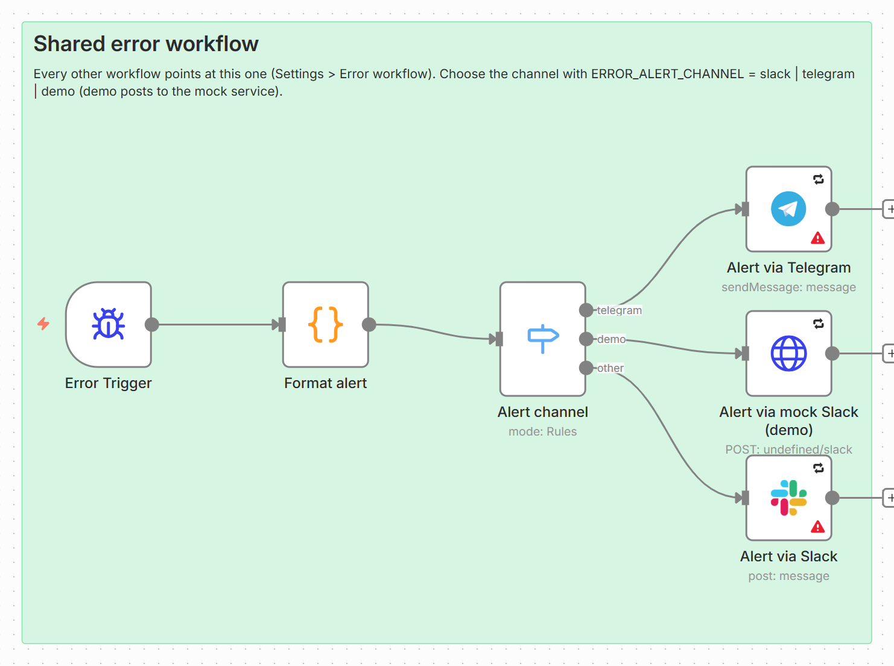
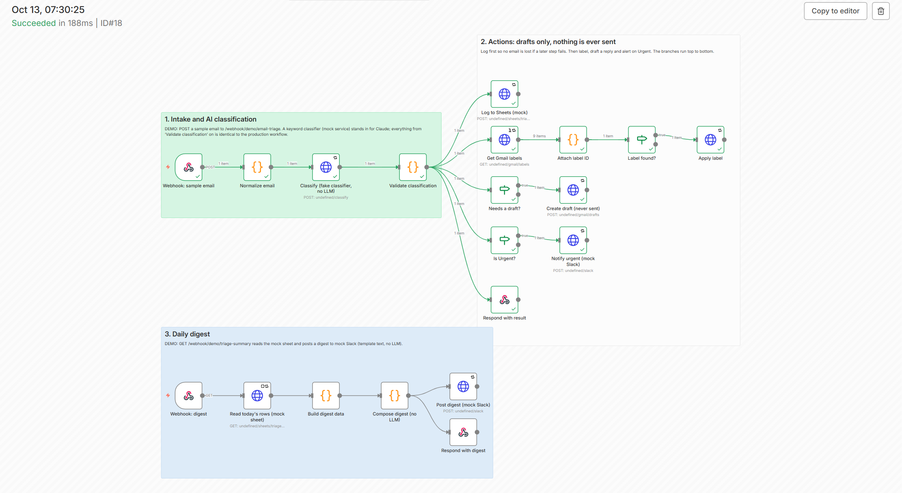
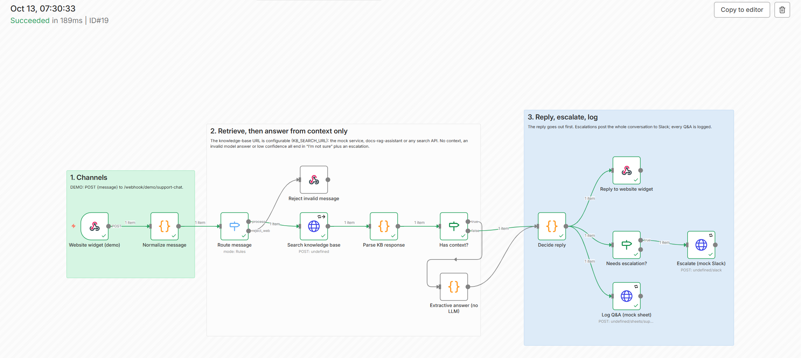
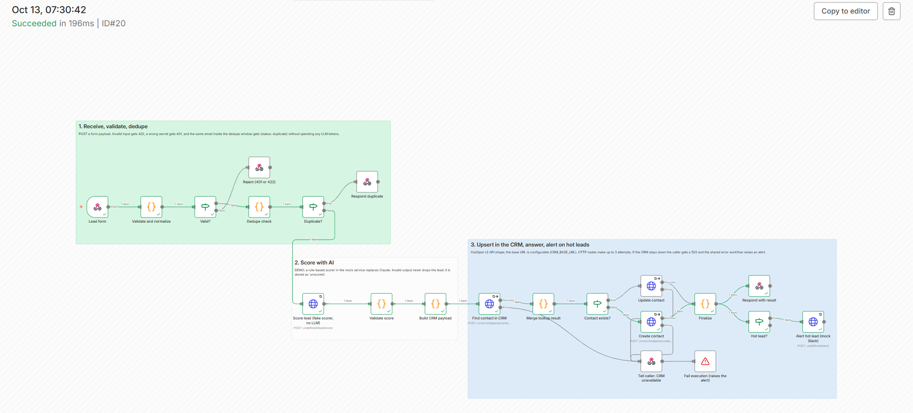

# n8n AI Workflows: Gmail triage, support chatbot (RAG) and lead intake

[](https://github.com/Aleksa5000/n8n-ai-workflows/actions/workflows/ci.yml)


**Three production-style n8n workflows that use an LLM (Claude by default, OpenAI is a node swap) without trusting it blindly: every model answer is schema-checked, every failure has a fallback, every integration has retries, and a shared error workflow tells you when something breaks.** Self-hostable, exported as plain JSON with no credentials inside, and runnable end to end on your laptop with **no accounts and no API keys** (demo mode).

| # | Workflow | What it does for the business |
|---|----------|-------------------------------|
| 1 | **Gmail AI triage** | Sorts every incoming email into 7 categories, labels it, writes a **draft** reply (never sends), pings you on Urgent, logs to Google Sheets and sends a daily digest. |
| 2 | **Support chatbot with knowledge base (RAG)** | Answers website-widget and Telegram questions **only from your documents**. If it is not sure, it says so, hands the conversation to a human in Slack and logs everything. |
| 3 | **Lead intake and qualification** | Validates form submissions, drops duplicates, scores each lead 0-100 with a reason, creates or updates the CRM contact and alerts Slack on hot leads. |
| 0 | **Shared error handler** | Any failure in any workflow becomes one Slack or Telegram message with the workflow name, failed node, error and a link to the execution. |

## The problem

Teams automate with n8n and an LLM node, and it works in the demo. Then a model answers with prose instead of JSON, the CRM times out for a minute, the same form is submitted twice, or the Gmail token expires, and the automation silently stops or, worse, sends something wrong. Typical rescue jobs are "repair my Gmail triage workflow" or "make my AI chatbot stop making things up".

This pack is a reference for doing it properly: **validate model output, fall back safely, retry transient failures, never lose a lead or an email, never send mail on your behalf, and alert a human when it matters.**

## Screenshots (real, from the running n8n editor)

Production workflows as imported into a fresh n8n 1.123.84. The red triangles are n8n saying "credentials not set": every credential-bound node is flagged, nothing else is (see [What was tested](#what-was-tested)).






Demo-mode executions of the same logic (green = ran, numbers = items passed), produced by the commands in the quickstart:





## How each workflow works

### 1. Gmail AI triage (`workflows/01-gmail-ai-triage.json`)

1. **Gmail Trigger** polls unread inbox mail every 2 minutes; "Normalize email" flattens it (body capped at 6,000 characters to bound cost).
2. **Claude** classifies it into `Urgent / Important / Client / Billing / Routine / Informational / Low Value` and returns JSON matching a strict schema (Structured Output Parser). The system prompt treats the email as untrusted data.
3. **"Validate classification"** (Code node) re-checks the answer: category in the enum, confidence 0 to 1, summary present, booleans are booleans. Prose, a wrong category, a missing field or a failed model call all become **`Routine`, confidence 0, no draft, `fallback = true`**. The email is never lost.
4. Four independent branches run top to bottom: **log to Google Sheets first** (so a later failure cannot lose the email), **apply the label** `AI/<Category>`, **create a Gmail draft** reply on the thread when a reply makes sense, and **alert Slack or Telegram** on Urgent (`NOTIFY_CHANNEL`).
5. **Daily digest** (second trigger on the same canvas): at 18:00 the day's rows are read from the sheet and Claude writes a short summary for Slack or Telegram. Skipped on days without email.

**It cannot send email.** The workflow only uses Gmail "get labels", "add label" and "create draft". A test fails if a send/reply operation ever appears.

### 2. Support chatbot with knowledge base (`workflows/02-support-chatbot-rag.json`)

1. Two entry points share one pipeline: a **website-widget webhook** (`POST /webhook/support-chat`) and a **Telegram Trigger**. WhatsApp: see [Adding WhatsApp](#adding-whatsapp-cloud-api).
2. **Search knowledge base** calls `KB_SEARCH_URL` (configurable). It understands a plain JSON search API and the SSE stream of [docs-rag-assistant](https://github.com/Aleksa5000/docs-rag-assistant); passages scoring below `KB_MIN_SCORE` are dropped.
3. **No context** (nothing above the threshold, or the knowledge base is down) skips the model entirely. **With context**, Claude is told to answer *only* from the `<passages>` and to return `{answer, answerable, confidence}`.
4. **"Decide reply"** accepts the answer only if the JSON is valid, `answerable` is true and `confidence >= ANSWER_MIN_CONFIDENCE` (default 0.6). Otherwise the user gets *"I'm not sure about that one..."* and the conversation goes to **Slack** with the reason.
5. The reply goes out first, then the escalation, then the **Q&A is logged to Google Sheets** (channel, question, answer, confidence, escalated, reason, sources).

### 3. Lead intake and qualification (`workflows/03-lead-intake-qualification.json`)

1. `POST /webhook/lead-intake` with a form payload. "Validate and normalize" checks the email and name, normalizes phone and casing, and optionally requires an `X-Webhook-Secret` header (401 otherwise). Invalid input gets **422** with the reasons.
2. **Dedupe by email**: the same email within `DEDUPE_WINDOW_MIN` (default 60) is answered with `{"status":"duplicate"}` and costs no LLM tokens. The store is written only after the CRM call succeeded, so a failed run never blocks the retry.
3. **Claude scores** the lead 0-100 with a reason. The **tier (hot/warm/cold) is derived in code** from `LEAD_HOT_SCORE` (70) and `LEAD_WARM_SCORE` (40), never taken from the model. Invalid output does not drop the lead: it is stored as `unscored` for a human.
4. **CRM upsert** over HTTP, HubSpot v3 API shape, base URL from `CRM_BASE_URL`: search by email, then update or create. AI score, tier and reason are written to custom properties.
5. **Hot leads** are announced in Slack. The caller gets `{status, crm_id, score, tier, reason}`.

## Demo quickstart (no accounts, no keys)

Requirements: Docker with Compose v2. The stack is bound to `127.0.0.1` only (n8n on **5679**, mock services on **8795**).

```bash
docker compose up -d --build            # n8n 1.123.84 + the mock-services container
bash scripts/import_workflows.sh        # imports the error handler + 3 demo workflows and activates them (~40 s, n8n restarts once)
bash samples/run_samples.sh             # fires every sample payload and prints what happened
```

Or call the webhooks yourself (payloads are in [`samples/`](samples)):

```bash
# 1. Gmail triage: accepts a sample email, runs the same validation and branching as the production workflow
curl -s -X POST http://127.0.0.1:5679/webhook/demo/email-triage -H 'Content-Type: application/json' -d @samples/email-urgent.json
curl -s -X POST http://127.0.0.1:5679/webhook/demo/email-triage -H 'Content-Type: application/json' -d @samples/email-bad-model-output.json   # invalid "LLM" output -> Routine
curl -s http://127.0.0.1:5679/webhook/demo/triage-summary                                                                                        # the daily digest

# 2. Support chatbot against the mock knowledge base
curl -s -X POST http://127.0.0.1:5679/webhook/demo/support-chat -H 'Content-Type: application/json' -d @samples/chat-refund.json    # answered
curl -s -X POST http://127.0.0.1:5679/webhook/demo/support-chat -H 'Content-Type: application/json' -d @samples/chat-unknown.json   # "I'm not sure" + Slack escalation

# 3. Lead intake against the mock CRM
curl -s -X POST http://127.0.0.1:5679/webhook/demo/lead-intake -H 'Content-Type: application/json' -d @samples/lead-hot.json
curl -s -X POST http://127.0.0.1:5679/webhook/demo/lead-intake -H 'Content-Type: application/json' -d @samples/lead-hot.json       # same email again -> duplicate

# What did n8n actually do? The mock services record everything.
curl -s http://127.0.0.1:8795/state
curl -s http://127.0.0.1:8795/slack/messages
curl -s http://127.0.0.1:8795/gmail/drafts            # drafts only: "sent": false, and there is no send endpoint
curl -s http://127.0.0.1:8795/crm/v3/objects/contacts
curl -s "http://127.0.0.1:8795/log?limit=20"          # every request n8n made
```

Prove the error handling yourself:

```bash
curl -s -X POST http://127.0.0.1:8795/admin/chaos -H 'Content-Type: application/json' -d '{"crm": 2}'   # next 2 CRM calls fail with 503
curl -s -X POST http://127.0.0.1:5679/webhook/demo/lead-intake -H 'Content-Type: application/json' -d '{"name":"Retry Rita","email":"rita@example.com","company":"Retry Inc","message":"Pricing for a retainer please"}'
#  -> still {"status":"created",...}: the HTTP node retried (the log shows two 503s, then 200)

curl -s -X POST http://127.0.0.1:8795/admin/chaos -H 'Content-Type: application/json' -d '{"crm": 10}'  # CRM "down"
curl -s -i -X POST http://127.0.0.1:5679/webhook/demo/lead-intake -H 'Content-Type: application/json' -d '{"name":"Down Dan","email":"dan@example.com","message":"hello"}'
#  -> HTTP 502 {"status":"error",...}, and curl http://127.0.0.1:8795/slack/messages shows the "[n8n ALERT]" from the error workflow
curl -s -X POST http://127.0.0.1:8795/admin/chaos -H 'Content-Type: application/json' -d '{"crm": 0}'
```

Open the editor at <http://127.0.0.1:5679>. n8n asks you to create the owner account on first visit (create your own), or run `bash scripts/setup_demo_owner.sh` to create the throw-away local demo owner from `.env.example`. To also look at the production workflows without credentials, run `bash scripts/import_workflows.sh all`. Clean up with `docker compose down -v`.

Note: the lead workflow remembers emails for 60 minutes, so re-sending the same email returns `duplicate`. That is the feature; `samples/run_samples.sh` makes its emails unique, or set `DEDUPE_WINDOW_MIN=0`.

### What demo mode replaces

| Production | Demo (same logic, no accounts) |
|------------|--------------------------------|
| Gmail Trigger | Webhook that accepts a sample email JSON |
| Claude classification / scoring / answering | Rule-based fake classifier, scorer and extractive answer in `mock-services` (the **validation code after them is the identical node**) |
| Gmail label, draft | `POST /gmail/...` on the mock (there is no "send" endpoint) |
| Slack, Telegram | `POST /slack` on the mock |
| Google Sheets | `POST /sheets/<name>/rows` on the mock |
| CRM (HubSpot v3 shape) | A mock with the same endpoints, plus failure injection |
| Knowledge base | `POST /kb/search` over 8 FAQ entries |

Every Code node that exists in both a production workflow and its demo twin is byte-identical (a test enforces it); the only intentional difference is the entry normalizer of the Gmail flow (Gmail item vs webhook payload).

## Production setup

1. **Run n8n** with the same `docker-compose.yml` (drop the `mock-services` service if you like), behind HTTPS. Set `N8N_ENCRYPTION_KEY` yourself and keep it: it protects the credentials stored in n8n. For heavier use switch to Postgres.
2. **Import**: `bash scripts/import_workflows.sh prod` (error handler + the 3 production workflows, inactive). Each workflow already points at the error workflow by ID.
3. **Create the credentials in n8n** (Credentials > New) and select them on the flagged nodes:

   | Credential type | Used by | Notes |
   |-----------------|---------|-------|
   | Gmail OAuth2 | Gmail Trigger, Get labels, Apply label, Create draft | Needs read, label and draft permission only. Create the labels `AI/Urgent`, `AI/Important`, `AI/Client`, `AI/Billing`, `AI/Routine`, `AI/Informational`, `AI/Low Value` once. |
   | Google Sheets OAuth2 | Log rows, digest, Q&A log | Sheet tabs and headers are listed in each node's notes ("Triage log", "Support Q&A"). |
   | Slack | Urgent alerts, digest, escalations, hot leads, errors | Bot token with `chat:write`; invite the bot to the channels. |
   | Telegram | Optional alternative to Slack, Telegram chatbot channel | Bot token from @BotFather. The Telegram Trigger needs a public HTTPS `WEBHOOK_URL`. |
   | Anthropic | The four "Claude (...)" model nodes | API key, ideally with a spend limit. |
   | Header Auth | The three CRM HTTP nodes | Name `Authorization`, value `Bearer <HubSpot private app token>` (scopes `crm.objects.contacts.read` and `.write`). |

4. **Set the environment variables** (`.env`, see [`.env.example`](.env.example)). The workflows read their settings with `$env`, so nothing is hard-coded:

   | Variable | Meaning | Default |
   |----------|---------|---------|
   | `ERROR_ALERT_CHANNEL` | `slack`, `telegram` or `demo` for the error workflow | `demo` (set `slack` in production) |
   | `NOTIFY_CHANNEL` | `slack` or `telegram` for urgent emails and the digest | `slack` |
   | `SLACK_CHANNEL_EMAIL` / `_SUPPORT` / `_LEADS` / `_ALERTS` | Slack channel IDs | empty |
   | `TELEGRAM_CHAT_ID` | Telegram chat for notifications | empty |
   | `TRIAGE_SHEET_ID`, `SUPPORT_SHEET_ID` | Google Sheet IDs | empty |
   | `KB_SEARCH_URL`, `KB_API_KEY`, `KB_MIN_SCORE` | Knowledge-base endpoint, optional `X-API-Key`, minimum passage score | mock service, empty, `0.4` |
   | `ANSWER_MIN_CONFIDENCE` | Minimum model confidence to answer | `0.6` |
   | `CRM_BASE_URL` | e.g. `https://api.hubapi.com` | mock service |
   | `LEAD_WEBHOOK_SECRET` | If set, the form must send `X-Webhook-Secret` | empty (open) |
   | `DEDUPE_WINDOW_MIN`, `LEAD_HOT_SCORE`, `LEAD_WARM_SCORE` | Dedupe window and tier thresholds | 60, 70, 40 |
   | `ANTHROPIC_MODEL` | Model ID for all Claude nodes | `claude-haiku-5-5` |
   | `WIDGET_ALLOWED_ORIGIN` | CORS origin for the website widget | `*` (restrict it) |

5. **Activate** the workflows. Webhook URLs: `/webhook/support-chat` (POST) and `/webhook/lead-intake` (POST).

### Using OpenAI instead of Claude

All LLM steps are a **Basic LLM Chain** with a swappable chat-model sub-node. To switch: delete the "Claude (...)" node, add an **OpenAI Chat Model** to the chain's *Model* input, pick the model and the OpenAI credential. The prompts, the structured-output parser and all validation code stay unchanged (the validation exists precisely so that the provider can change). `ANTHROPIC_MODEL` is then unused.

### Knowledge base: the mock, docs-rag-assistant, or your own

The retrieval URL is `KB_SEARCH_URL`; the request body is `{"question": "...", "top_k": 4}`; the "Parse KB response" node accepts either:

* **JSON**: `{"results": [{"text": "...", "source": "faq.md", "score": 0.9}]}` (what `mock-services` returns). `filename` or `title` also work in place of `source`.
* **docs-rag-assistant's SSE stream**: only its `sources` event is read.

The real [docs-rag-assistant](https://github.com/Aleksa5000/docs-rag-assistant) API is `POST /api/chat` (not `/api/ask`) with `{"question": ...}`, answering with Server-Sent Events `sources`, `token`, `done`; set `X-API-Key` via `KB_API_KEY` if you configured `APP_API_KEY`. Its scores are BM25, not 0 to 1: in my test relevant passages scored about 4 to 10 and an unrelated question returned none, so use `KB_MIN_SCORE=4` and tune.

```bash
KB_SEARCH_URL=http://<host>:8000/api/chat  KB_MIN_SCORE=4  docker compose up -d
```

Two caveats. With an Anthropic key configured, `/api/chat` also generates a full answer that this workflow does not use, and the HTTP node waits for the stream to finish. Either run a retrieval-only instance (no key) or add a small JSON endpoint to docs-rag-assistant (not applied to that repository by this project):

```python
@app.post("/api/search", dependencies=auth)
def search(req: ChatRequest):
    return {"results": number_sources(store.search(req.question.strip()))}   # text, filename, score: already understood by the workflow
```

### Adding WhatsApp Cloud API

Not built or tested here, but the pipeline is channel-agnostic, so it is three small changes: (1) add a **WhatsApp Trigger** node (Meta developer app, WhatsApp Business Cloud credentials) next to the Telegram Trigger; (2) in "Normalize message" add a branch for items with `messages[0]` that sets `channel: 'whatsapp'`, `chat_id: messages[0].from`, `question: messages[0].text.body`, `session_id: 'wa-' + from`; (3) add a third output `whatsapp` to "Reply router" that goes to a **WhatsApp Business Cloud** "Send message" node using `{{ $json.chat_id }}` and `{{ $json.reply_text }}`. Check the trigger's actual output in a test execution before mapping fields.

### Using a CRM other than HubSpot

The three CRM HTTP nodes use HubSpot's v3 contact endpoints (`/search`, create, `PATCH`). For HubSpot you only set `CRM_BASE_URL` and the Header Auth credential, and create the custom contact properties `ai_lead_score` (number), `ai_lead_tier`, `ai_lead_reason` and `lead_source` (text). For Pipedrive (`GET /v1/persons/search?term=<email>&fields=email&exact_match=true`, `POST /v1/persons`, `PUT /v1/persons/{id}`) change the three URLs and methods and the field mapping in "Build CRM payload" and "Merge lookup result". Not built.

## Error handling

| Failure | What happens |
|---------|--------------|
| Model returns prose, bad JSON, wrong enum, out-of-range number | Caught by the validation Code node. Email becomes `Routine` (no draft, flagged), chatbot answer becomes "I'm not sure" plus escalation, lead becomes `unscored` (still saved). |
| Model call fails (rate limit, outage) | The chain tries twice, then "continue on error" feeds the same fallbacks. |
| Knowledge base empty, below threshold or **down** | The model is not called; the user gets "I'm not sure" and Slack gets the reason (`knowledge base unavailable: ...`). |
| Transient HTTP/Slack/Sheets/Gmail error | `retryOnFail`, 3 tries, 2 s apart on every HTTP and integration node. |
| CRM stays down | Retries exhausted, the caller gets **502** (n8n would otherwise answer `200` with an empty body, which I verified on 1.123.84), and the execution is failed on purpose so the error workflow alerts. |
| Duplicate submission | Answered as `duplicate`, no tokens spent, no second CRM write. |
| Anything else unhandled | **Error workflow**: `[n8n ALERT] Workflow failed: <name> / Failed node / Error / Execution URL` to Slack or Telegram. Every workflow's *Settings > Error workflow* points to it (a test checks this). |
| A later step fails in the Gmail flow | The email was already logged to the sheet first, so you can find and handle it; the error workflow tells you which node failed. |

Webhook-only demo workflows keep successful executions (so you can inspect them); production workflows set `saveDataSuccessExecution: none` so email and lead content is not stored in n8n by default, while failed executions are kept for debugging.

## Security notes

* **No secrets in the exports.** Workflows contain no `credentials` blocks, tokens or keys (tests scan for common secret formats). Credentials live in n8n's encrypted store; settings live in environment variables.
* **Least privilege.** Gmail: only read, label and draft, and the workflow has no send step. Slack: `chat:write`. CRM: a private-app token limited to contacts. Create your own OAuth clients instead of broad shared ones.
* **LLM inputs are untrusted.** Email bodies, chat messages, form fields and retrieved passages are passed as data with instructions not to follow them; passages are HTML-escaped; model output is validated before it triggers anything; the model can never choose the lead tier or trigger a send.
* **Webhooks.** `LEAD_WEBHOOK_SECRET` adds a shared-secret header (plain string comparison: fine behind HTTPS, use a reverse proxy or n8n's header-auth credential for stronger needs). The public chat widget endpoint should sit behind rate limiting; set `WIDGET_ALLOWED_ORIGIN` to your site.
* **Bounded cost.** Inputs are length-capped (email 6,000 characters, question 1,000, chat history 6 turns), model output is token-capped, duplicates never reach the model.
* Workflows read their settings with `$env`, which needs `N8N_BLOCK_ENV_ACCESS_IN_NODE=false`. That lets anyone who can edit a workflow read the container's environment, so give editor access only to people you trust.
* The compose file publishes ports on `127.0.0.1` only and sets `N8N_SECURE_COOKIE=false` for plain-http local use: remove that behind HTTPS.
* The demo owner password in `.env.example` is for a throw-away local instance only.

## What was tested

Honest status, so you know what you are getting.

**Ran end to end, for real, against n8n 1.123.84 in Docker (demo mode):**

* `docker compose up`, import, activation via the CLI, and **23 scripted checks** in `scripts/smoke_demo.py`, all passing: urgent / informational / bad-model-output emails, the digest, answered / unknown / weak-match / empty chatbot questions with Slack escalation containing the conversation, a hot lead, duplicate, 422, update of an existing contact, an unscored lead, CRM failing twice then recovering (retries), and CRM down (502 plus the error-workflow alert with workflow, node and execution URL).
* Retrieval against the **real docs-rag-assistant** (its SSE `/api/chat` in its no-key demo mode, BM25 scores, `KB_MIN_SCORE=4`): relevant questions answered from its sources, an unrelated question escalated.
* All 7 workflows imported with `n8n import:workflow` and opened in the editor (the screenshots are from that editor). n8n reports issues only on credential-bound nodes ("Credentials for X are not set") and no parameter problems.

**Statically validated only (they need real accounts, so they were never executed):**

* The production workflows' Gmail Trigger, Gmail nodes, Google Sheets nodes, Slack and Telegram nodes, the Schedule Trigger, and the real **Anthropic Chat Model + Basic LLM Chain + Structured Output Parser** path. Their JSON imports cleanly and their parameters were written against the node definitions shipped in 1.123.84, but I have not run them. The first thing to do with real accounts is send one email and one chat message and watch the execution.
* The real **HubSpot** API: the mock implements the v3 contact endpoints as I understand them; field names and custom properties must exist in your portal.
* Telegram (needs public HTTPS), WhatsApp (described only), Pipedrive (described only), OpenAI swap (described only).

**Automated tests (`pytest`, 160 tests):** workflow JSON validation (parses, required keys, known node types and versions, unique ids, no credentials or secrets, every node connected, AI sub-nodes wired, retry settings on every HTTP node, error workflow set everywhere, no send operation in the Gmail flow, demo and production Code nodes identical, generator output up to date), the Code-node JavaScript run under `node` against edge cases (invalid model output, thresholds, SSE parsing, dedupe window, escalation reasons) and the mock-services API with `TestClient`. CI runs `ruff` and `pytest`, and a second job starts the Docker stack and runs `smoke_demo.py`; **that CI job is written but has not yet run on GitHub**, it executes the same commands that passed locally.

Known limits: the dedupe store is n8n workflow static data (per instance, not shared across queue-mode workers, not saved by manual test runs); the Telegram path has no conversation memory; "Normalize email" uses the plain-text body only; the pinned n8n is the last 1.x line, newer 2.x releases are untested.

## Repository layout

```
workflows/            00-error-handler, 01..03 production workflows, demo/ twins (importable JSON)
scripts/
  build_workflows.py  generates the JSON above (Code-node JavaScript lives in scripts/code_nodes/*.js)
  import_workflows.sh imports into the compose n8n (demo | prod | all)
  smoke_demo.py       end-to-end checks against the running demo stack
  setup_demo_owner.sh, capture_screenshots.py   local helpers
mock-services/        FastAPI: fake CRM, KB, classifier, Gmail, Slack, Sheets, request log, failure injection
samples/              payloads + run_samples.sh (curl)
tests/                pytest (workflow validation, Code-node unit tests, mock API)
docker-compose.yml    n8n (pinned) + mock-services, loopback only
```

Edit the workflows in the n8n UI if you like, but the committed JSON is generated: change `scripts/build_workflows.py` or `scripts/code_nodes/*.js`, run `python scripts/build_workflows.py`, and CI (`--check`) keeps the JSON in sync. Development: `pip install -r requirements-dev.txt`, then `ruff check .` and `pytest -q`.

## Need something similar?

I build n8n automations, LLM integrations and Python tooling for small teams: inbox triage, support copilots, lead pipelines, CRM and Sheets sync, and repairs of existing workflows. **Need something similar? Contact me on Upwork** (Aleksa Djorovic, Python automation and AI integration).

## License

MIT, see [LICENSE](LICENSE).
